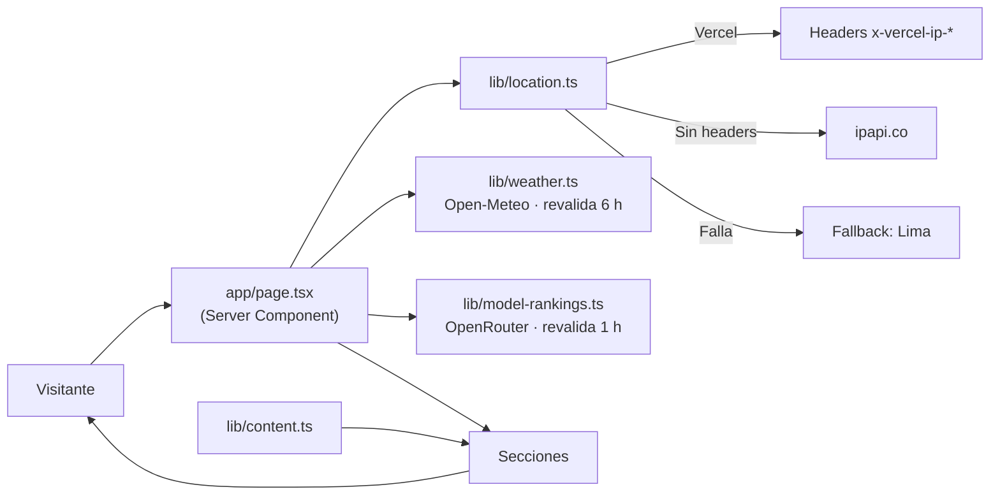

# Portfolio Next 🔌

[](https://forthebadge.com)
[](https://www.linkedin.com/in/drphp/)

<a href="https://amvsoft.metadatape.com/assets/hero-night-video.mp4">
    
</a>

> Portfolio de ingeniería **full-stack y AI-first**: una landing editorial pensada para convertir visitas en conversaciones. Está renderizada en el servidor, no tiene backend propio y enriquece el hero con contexto en vivo (hora del día, ubicación, clima y ranking de modelos de IA).

## En resumen

- **Next.js 16 App Router + React 19.** La home es un Server Component: los datos externos se resuelven en el servidor y el cliente recibe props listas para pintar.
- **Sin base de datos ni API propia.** El contenido vive en un único módulo tipado (`lib/content.ts`); los servicios externos son opcionales y cada uno tiene un respaldo.
- **i18n en cliente (EN / ES / DE)**, persistida en `localStorage` sin romper la hidratación.
- **Motion con criterio:** animaciones centralizadas y respeto a `prefers-reduced-motion`.
- **Diseño por tokens:** la marca se cambia en `app/globals.css`, no componente por componente.

## Recorrido de la página

| # | Sección | Objetivo |
| --- | --- | --- |
| — | Hero | Posicionamiento, disponibilidad del trimestre, hora local, clima y ranking de modelos. Video de día o de noche según la hora del visitante. |
| — | Practice strip | Enfoque técnico en una línea. |
| 01 | Selected Work | Evidencia: proyectos reales y su resultado. |
| 02 | Capabilities | Áreas de especialización. |
| 03 | Approach | Proceso de trabajo. |
| 04 | Stack | Criterio tecnológico. |
| 05 | About | Perfil y datos clave. |
| 06 | Contact | Llamado a la acción (correo y reunión de introducción). |

## Arquitectura



### Decisiones y trade-offs

| Decisión | Por qué |
| --- | --- |
| Fetch en el servidor y Data Cache de Next | Las claves nunca llegan al navegador; no hay *waterfalls* en el cliente; las APIs gratuitas reciben pocas peticiones. |
| Coordenadas redondeadas a 2 decimales para el clima | Visitantes cercanos comparten la misma entrada de caché y no se guarda una ubicación más precisa de lo necesario. |
| Cadena de respaldo para la ubicación | Ningún proveedor externo bloquea el render; en el peor caso se muestra Lima. |
| Rankings opcionales y sin datos ficticios | Sin `OPENROUTER_API_KEY` el widget dice que no hay datos, en lugar de inventarlos. |
| Idioma resuelto después de hidratar | El servidor y el primer render del cliente son idénticos; el idioma guardado se aplica en un efecto. |
| Contenido como módulo tipado y no como CMS | Para un sitio de una sola persona, un CMS añade infraestructura sin aportar valor. TypeScript valida la forma del contenido. |

## Stack

| Capa | Tecnología |
| --- | --- |
| Framework | Next.js 16.1 (App Router, Turbopack) |
| UI | React 19.2, shadcn/ui, Radix y Base UI |
| Lenguaje | TypeScript 5.9 (strict) |
| Estilos | Tailwind CSS v4 y PostCSS |
| Animación | Motion (`motion/react`) |
| Iconos y fuentes | Phosphor Icons, Geist y Geist Mono |
| Datos externos | Open-Meteo, ipapi.co, OpenRouter (opcional) |
| Calidad | ESLint 9, Prettier con plugin de Tailwind, `react-doctor` |

## Estructura

```text
app/
  layout.tsx          Metadata, fuentes, header/footer y providers
  page.tsx            Composición server-side de la home
  globals.css         Tokens de diseño
components/
  ui/                 Primitivas (shadcn)
  widgets/            Selector día/noche, localizador, ranking de modelos
  *.tsx               Una sección por archivo
lib/
  content.ts          Fuente única del contenido editorial
  i18n.ts, i18n-de.ts Diccionarios y helpers de idioma
  location.ts         Ubicación con respaldo (Vercel → ipapi → Lima)
  weather.ts          Clima cacheado (Open-Meteo)
  model-rankings.ts   Ranking de modelos (OpenRouter, opcional)
  availability.ts     Trimestre de disponibilidad
  motion.ts           Variantes de animación compartidas
public/assets/        Videos, posters y portadas de proyectos
```

## Puesta en marcha

Requisitos: Node.js 20.9+ o Bun 1.2+.

```bash
git clone https://github.com/phpeitor/portfolio-next.git
cd portfolio-next
bun install          # o npm install
bun dev              # http://localhost:3000
```

### Variables de entorno

| Variable | Obligatoria | Uso |
| --- | --- | --- |
| `OPENROUTER_API_KEY` | No | Activa el widget de ranking de modelos. Solo se lee en el servidor. |

Guárdala en `.env.local`. No uses el prefijo `NEXT_PUBLIC_`: expondría la clave en el bundle del navegador.

## Comandos

| Comando | Propósito |
| --- | --- |
| `bun dev` | Desarrollo con Turbopack |
| `bun run build` | Build de producción |
| `bun run start` | Servir el build |
| `bun run lint` | ESLint |
| `bun run typecheck` | `tsc --noEmit` |
| `bun run format` | Prettier sobre TS/TSX |
| `bun run doctor` | Diagnóstico de React |

Antes de abrir un PR: `typecheck`, `lint` y `build` deben pasar.

## Despliegue

**Vercel (recomendado):** se importa el repositorio y no requiere configuración. Vercel inyecta los headers de geolocalización que usa `lib/location.ts`.

**Self-hosted (VPS):** `bun run build` y después `bun run start` detrás de un reverse proxy (Nginx o Caddy), supervisado por systemd o pm2. Tras cada despliegue hay que recompilar y reiniciar el proceso: `next start` sirve el build anterior hasta que se reinicia.

> ⚠️ Fuera de Vercel no hay headers `x-vercel-ip-*`, así que `ipapi.co` resuelve la IP **del servidor** y no la del visitante: el hero mostrará la ubicación y el clima del VPS. Para ubicar al visitante, hay que leer la IP de `x-forwarded-for` o los headers de geolocalización del proxy o CDN (por ejemplo, `cf-ipcity` de Cloudflare) en `lib/location.ts`.

## Personalización

| Qué | Dónde |
| --- | --- |
| Textos, proyectos, navegación y enlaces | [`lib/content.ts`](./lib/content.ts) |
| Traducciones | [`lib/i18n.ts`](./lib/i18n.ts), [`lib/i18n-de.ts`](./lib/i18n-de.ts) |
| Colores, tipografía y espaciado | [`app/globals.css`](./app/globals.css) |
| SEO y Open Graph | [`app/layout.tsx`](./app/layout.tsx), [`app/page.tsx`](./app/page.tsx) |
| Videos y posters del hero | `public/assets/` y el mapa `MEDIA` en [`components/hero.tsx`](./components/hero.tsx) |
| Prompts usados para generar la media | [`lib/prompts.md`](./lib/prompts.md) |

Los videos del hero pesan entre 6 y 8 MB. Si los reemplazas, mantenlos cortos y comprimidos, y conserva el poster `.webp`: es lo que se pinta primero y lo que cuenta para el LCP.

## Límites conocidos

- `ipapi.co` aplica *rate limits*; si responde con error, se usa el respaldo de Lima.
- Si Open-Meteo u OpenRouter no responden, sus widgets muestran un estado vacío y la página se renderiza igual.
- La ubicación es aproximada y solo decora la experiencia; no se usa para identificar a nadie ni se guarda.

## Licencia

Ver [`LICENSE`](./LICENSE).
