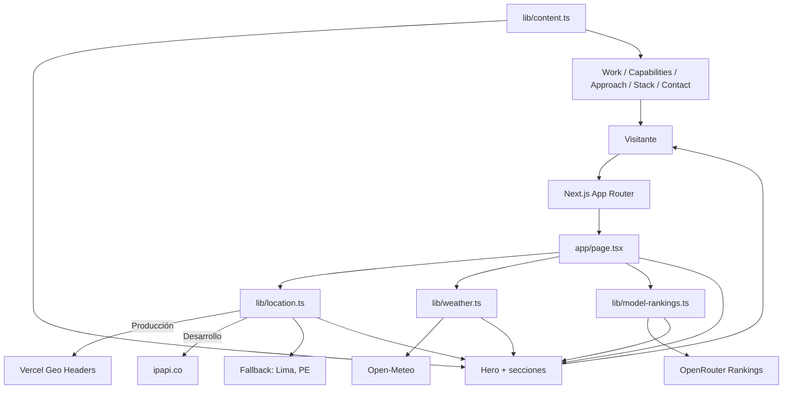

# Portfolio Next </>

[](https://forthebadge.com)
[](https://www.linkedin.com/in/drphp/)

<a href="https://www.instagram.com/amvsoft.tech/">
    <video width="640" height="360" controls>
    <source src="https://amvsoft.metadatape.com/assets/hero-background-video.mp4" type="video/mp4">
    Tu navegador no soporta videos HTML.
    </video>
  <video src="https://amvsoft.metadatape.com/assets/hero-background-video.mp4"
</a>

Portfolio personal orientado a ingeniería **full-stack y AI-first**. La aplicación presenta proyectos, capacidades, proceso de trabajo y stack técnico en una experiencia editorial responsive, con un hero dinámico que adapta su contexto visual al momento del día y a la ubicación aproximada del visitante.

El proyecto está construido con Next.js App Router y prioriza:

- renderizado de datos en el servidor;
- una fuente centralizada para el contenido del portfolio;
- caché y revalidación para servicios externos;
- accesibilidad, responsive design y soporte para `prefers-reduced-motion`;
- una superficie de configuración pequeña, sin backend propio ni base de datos.

## Contexto del producto

Este sitio no es una aplicación CRUD: es una **landing page de alto impacto para convertir visitas en conversaciones profesionales**. Cada sección cumple una función concreta dentro del recorrido:

1. **Hero:** comunica posicionamiento, disponibilidad, ubicación, clima y contexto de IA.
2. **Practice strip:** resume el enfoque técnico.
3. **Selected Work:** muestra evidencia de producto y ejecución.
4. **Capabilities:** agrupa las áreas de especialización.
5. **Approach:** explica el proceso de trabajo.
6. **Stack:** hace visible el criterio tecnológico.
7. **Contact:** convierte el interés en una acción.

La interfaz mantiene una estética editorial: canvas cálido, tipografía display ligera, bordes sutiles y un acento naranja. Los tokens visuales viven en `app/globals.css`, por lo que los cambios de marca no requieren editar cada componente.

## Arquitectura y flujo de datos

La página principal es un Server Component. En cada render, `app/page.tsx` obtiene los datos contextuales y los entrega al hero como props serializables. Los servicios externos se consultan en el servidor: las credenciales nunca llegan al navegador.



### Decisiones técnicas relevantes

- **Ubicación:** en Vercel se priorizan `x-vercel-ip-*`; en local se usa `ipapi.co`; si ambos fallan, se muestra una ubicación estable de Lima.
- **Clima:** Open-Meteo recibe coordenadas redondeadas a dos decimales para compartir entradas de caché entre visitantes cercanos y evitar precisión innecesaria.
- **Revalidación:** clima cada 6 horas y rankings de modelos cada hora mediante la Data Cache de Next.js.
- **Rankings:** son opcionales. Sin `OPENROUTER_API_KEY`, el widget informa que los datos globales no están disponibles; no se muestran valores ficticios.
- **Motion:** las animaciones se concentran en componentes reutilizables y respetan `prefers-reduced-motion`.
- **Contenido:** `lib/content.ts` funciona como contrato editorial para navegación, proyectos, capacidades, stack y enlaces.

## Stack

| Capa | Tecnología |
| --- | --- |
| Framework | Next.js 16.1 · App Router · Turbopack |
| UI | React 19.2 |
| Lenguaje | TypeScript 5.9 |
| Estilos | Tailwind CSS v4 · PostCSS |
| Componentes | shadcn/ui · Radix/Base UI |
| Animación | Motion (`motion/react`) |
| Iconos | `@phosphor-icons/react` |
| Fuentes | Geist y Geist Mono |
| Clima | Open-Meteo |
| Geolocalización | Vercel Geo Headers + `ipapi.co` en local |
| Rankings de modelos | OpenRouter API, opcional |
| Package manager | Bun (también npm, pnpm o yarn) |

## Estructura del proyecto

```text
.
├── app/
│   ├── layout.tsx          # Metadata, fuentes, header/footer y providers
│   ├── page.tsx            # Composición server-side de la página
│   └── globals.css         # Tokens de diseño y estilos globales
├── components/
│   ├── ui/                 # Primitivas reutilizables
│   ├── widgets/            # Widgets con comportamiento específico
│   └── *.tsx               # Secciones del portfolio
├── lib/
│   ├── content.ts          # Fuente central de contenido editorial
│   ├── location.ts         # Resolución server-side de ubicación
│   ├── weather.ts          # Consulta cacheada a Open-Meteo
│   ├── model-rankings.ts   # Consulta opcional a OpenRouter
│   ├── i18n.ts             # Traducciones y helpers de idioma
│   ├── motion.ts           # Variantes compartidas de animación
│   └── utils.ts            # Utilidades comunes
├── public/assets/          # Videos, posters, favicon e imágenes de proyectos
├── next.config.mjs         # Configuración de imágenes locales
├── package.json            # Scripts y dependencias
└── bun.lock                # Lockfile reproducible de Bun
```

## Requisitos

- Node.js `20.9+` o Bun `1.2+`.
- Una clave de OpenRouter solo si se quiere activar el widget de rankings globales.

## Instalación y desarrollo

```bash
git clone https://github.com/phpeitor/portfolio-next.git
cd portfolio-next
bun install
bun dev
```

Abre [http://localhost:3000](http://localhost:3000). También puedes usar npm, pnpm o yarn:

```bash
npm install
npm run dev
```

### Variables de entorno

La única variable opcional es:

```env
OPENROUTER_API_KEY=tu_clave_de_openrouter
```

Guárdala en `.env.local`. La variable solo se consume en `lib/model-rankings.ts`, en el servidor. No la expongas en variables con prefijo `NEXT_PUBLIC_` ni la incluyas en el repositorio.

## Personalización

| Necesidad | Archivo |
| --- | --- |
| Nombre, biografía, navegación, proyectos y enlaces | [`lib/content.ts`](./lib/content.ts) |
| Colores, tipografía, spacing y tokens | [`app/globals.css`](./app/globals.css) |
| SEO, Open Graph, favicon y fuentes | [`app/layout.tsx`](./app/layout.tsx) |
| Composición de la home y metadata específica | [`app/page.tsx`](./app/page.tsx) |
| Hero de día/noche y posters | `public/assets/` |
| Prompts de generación de media | [`lib/prompts.md`](./lib/prompts.md) |

Para sustituir los videos del hero, conserva los nombres `hero-background-video.mp4` y `hero-night-video.mp4`, o actualiza las rutas en el componente correspondiente. Mantén los archivos comprimidos y breves para no penalizar el LCP.

## Calidad y comandos

| Comando | Propósito |
| --- | --- |
| `bun dev` | Desarrollo con Turbopack |
| `bun run build` | Build optimizado de producción |
| `bun run start` | Servir el build de producción |
| `bun run lint` | Ejecutar ESLint |
| `bun run typecheck` | Validar tipos sin emitir archivos |
| `bun run format` | Formatear TypeScript/TSX con Prettier |
| `bun run doctor` | Diagnóstico de React |

Antes de abrir un pull request:

```bash
bun run typecheck
bun run lint
bun run build
```

## Despliegue

El proyecto está preparado para Vercel sin configuración adicional:

1. Importa el repositorio en [Vercel](https://vercel.com/new).
2. Configura `OPENROUTER_API_KEY` únicamente si necesitas rankings.
3. Usa `bun run build` como verificación local antes de desplegar.
4. Publica.

En producción, Vercel proporciona los headers de geolocalización que consume `lib/location.ts`. Si esos headers no están disponibles, el código conserva el fallback definido y la página sigue siendo renderizable.

## Operación y límites conocidos

- `ipapi.co` puede aplicar rate limits durante el desarrollo local; el fallback evita bloquear el render.
- Open-Meteo y OpenRouter pueden no responder. Los widgets degradan a un estado sin datos y no deben impedir que el portfolio se renderice.
- La ubicación es aproximada y se usa solo para enriquecer la experiencia visual; no es un mecanismo de autenticación ni de identificación.
- El proyecto no persiste datos de visitantes y no requiere base de datos.

## Licencia

Consulta [`LICENSE`](./LICENSE) para las condiciones de uso, modificación y distribución del código.
